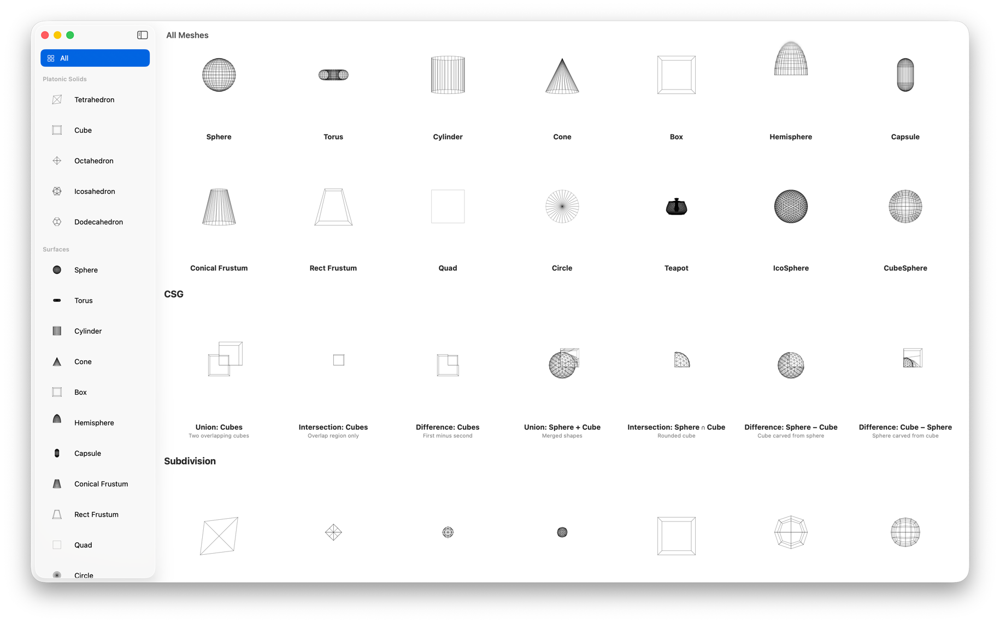

# SwiftMesh

SwiftMesh is a Swift library for 3D meshes. It stores meshes as half-edge topology with n-gon faces. It edits them and exports them to Metal.



## Quick start

```swift
import SwiftMesh

let mesh = Mesh.cube()
    .withSmoothNormals()
    .withSphericalUVs()

let metalMesh = MetalMesh(mesh: mesh, device: device)
encoder.draw(metalMesh)
```

## Types

**`HalfEdgeTopology`** connects vertices, half-edges, and faces. It stores no positions. Use it for adjacency queries, validation, boundary loops, and edge deletion or collapse.

**`Mesh`** is the type that you edit. It adds vertex positions and optional per-corner attributes (normals, UVs, tangents, bitangents, colors) to a `HalfEdgeTopology`. Faces can have any number of sides and can have holes. Submeshes put faces into groups, usually one group for each material.

**`Mesh2D<ID>`** is the 2D version of `Mesh`. It has `CGPoint` positions and a label of type `ID` on each half-edge. It builds a planar subdivision from line segments. It also finds holes, gives signed face areas, and merges faces when you delete an edge. The DocC documentation has a full page about `Mesh2D`.

**`MetalMesh`** is the type that you draw. It holds triangles in Metal buffers. The vertex buffers can be interleaved or separate. Each submesh has its own `indexType` (`.uint16` or `.uint32`) and `primitiveType`.

**`SwiftMeshIO`** reads and writes PLY files in ASCII and binary format.

## Loading & conversion

```swift
// From ModelIO
let metalMesh = try MetalMesh(mdlMesh: mdlMesh, device: device)   // keeps every attribute
let metalMeshes = try [MetalMesh](mdlAsset: asset, device: device) // world transforms baked in
let metalMesh = MetalMesh(mtkMesh: mtkMesh)
let mesh = try Mesh(mdlMesh: mdlMesh, device: device)              // via MetalMesh; triangles only
let meshes = try [Mesh](mdlAsset: asset, device: device)
let mdlMesh = mesh.toMDLMesh(device: device)

// From PLY (SwiftMeshIO)
let mesh = try PLY.read(from: data)
let data = PLY.write(mesh, format: .ascii)

// Between types
let metalMesh = MetalMesh(mesh: mesh, device: device) // Mesh → MetalMesh (lossy)
let metalMesh = MetalMesh(mesh: mesh, device: device, preserveTopology: true) // lossless
let mesh = Mesh(metalMesh: metalMesh)      // MetalMesh → Mesh
```

## Shape primitives

```swift
// Platonic solids
Mesh.tetrahedron()     // 4 triangle faces
Mesh.cube()            // 6 quad faces
Mesh.octahedron()      // 8 triangle faces
Mesh.icosahedron()     // 20 triangle faces
Mesh.dodecahedron()    // 12 pentagon faces

// Surfaces
Mesh.sphere()          // UV sphere
Mesh.icoSphere()       // subdivided icosahedron
Mesh.cubeSphere()      // cube projected onto sphere
Mesh.torus()           // configurable major/minor radii
Mesh.cylinder()        // optional caps
Mesh.cone()            // optional base cap
Mesh.hemisphere()      // optional cap
Mesh.capsule()         // sphere-capped cylinder
Mesh.conicalFrustum()  // truncated cone, optional caps
Mesh.rectangularFrustum() // truncated box, optional caps
Mesh.box()             // unit box with quad faces
Mesh.quad()            // single quad
Mesh.triangle()        // single triangle
Mesh.circle()          // flat disc
Mesh.teapot()          // Utah teapot

// Procedural
Mesh.convexHull(of: points)                                 // 3D convex hull (incremental)
Mesh.marchingCubes(resolution: [64, 64, 64]) { sdf($0) }    // isosurface of a scalar field
Mesh.extruded(path, depth: 0.2)                             // SwiftUI.Path or CGPath → solid; nested subpaths become holes
mesh.wireframe(radius: 0.01)                                // "phat" wireframe — prisms along edges
```

## Operations

### Attributes

```swift
mesh.withFlatNormals()       // per-face normals
mesh.withSmoothNormals()     // averaged vertex normals
mesh.withSphericalUVs()      // spherical projection
mesh.withCylindricalUVs()    // cylindrical projection
mesh.withPlanarUVs()         // planar projection
mesh.withBoxUVs()            // box-mapped UVs
mesh.withTangents()          // MikkTSpace tangents (needs normals + UVs)
```

### Transforms

```swift
mesh.translated(by: [1, 0, 0])
mesh.scaled(by: 2.0)
mesh.scaled(by: [1, 2, 1])
mesh.rotated(by: quaternion)
mesh.transformed(by: matrix)
```

### Topology

```swift
mesh.triangulated()                    // n-gons → triangles
mesh.welded(tolerance: 1e-5)           // merge near-duplicate vertices, rebuild topology
mesh.mergingCoplanarFaces()            // merge adjacent coplanar faces back to n-gons
mesh.reversingWinding()                // flip every face (inside-out)
mesh.isManifold                        // true if closed 2-manifold (no boundary edges)
mesh.validate()                        // [ValidationIssue]; empty if valid
```

### Editing

```swift
mesh.splitEdge(halfEdgeID, at: 0.5)                 // insert a vertex; adjacent triangles split in two
mesh.extrudingFace(faceID, distance: 0.3)           // push a face out along its normal, with side walls
mesh.flipEdge(halfEdgeID)                           // flip the diagonal shared by two triangles
mesh.chamfered(distance: 0.05, segments: 2)         // bevel edges; nil unless the mesh is a closed manifold
mesh.fillingHoles()                                 // close boundary loops with new faces
let (front, back) = mesh.split(planeNormal: [0, 1, 0], point: .zero)  // clip and cap; capped: false leaves it open
```

### Diagnostics

```swift
mesh.topology.boundaryLoopCount        // 0 = watertight
mesh.topology.hasOrphanedVertices
mesh.topology.hasDanglingEdges
mesh.topology.hasNonConsistentTwins
mesh.topology.hasNonConsistentNextPrev
mesh.topology.hasDuplicateFaces
mesh.topology.hasDuplicateEdges
mesh.topology.valenceHistogram()       // [valence: vertex count]
mesh.hasZeroAreaFaces()
mesh.hasNonPlanarFaces(tolerance: 1e-5)
```

### Subdivision

```swift
mesh.loopSubdivided(iterations: 2)          // Loop (triangle meshes)
mesh.catmullClarkSubdivided(iterations: 2)  // Catmull-Clark (any polygon mesh)
```

### Decimation

```swift
mesh.decimated(ratio: 0.5)              // reduce to 50% of faces
mesh.decimated(targetFaceCount: 100)     // reduce to exact count
```

Decimation collapses edges in the order of quadric error. It triangulates n-gon faces first. The result has no unused vertices, half-edges, or faces.

### CSG (Constructive Solid Geometry)

```swift
meshA.union(meshB)          // A ∪ B
meshA.intersection(meshB)   // A ∩ B
meshA.difference(meshB)     // A − B
```

The Boolean code is a port of [Manifold](https://github.com/elalish/manifold) (Apache-2.0, see `NOTICE`).

- Both inputs must be closed manifolds. CSG first merges vertices at the same position, for example at UV seams.
- If an input is not a closed manifold, the result is empty.
- If both inputs are closed manifolds, the result is a closed manifold.
- Symbolic perturbation resolves exact ties, such as faces that touch or are coplanar. Thus, two solids that touch union into one solid, and a mesh minus itself is empty.
- CSG interpolates per-corner attributes onto the result.
- A mesh with no faces is the empty solid.

```swift
mesh.windingNumbers(at: points)  // robust point-in-solid query (1 inside, 0 outside)
```

### Merging

```swift
Mesh.merged([meshA, meshB, meshC])  // concatenate; each source becomes a submesh
```

### Planar atlas baking

```swift
// Partition into connected coplanar charts, then bin-pack into a UV atlas.
let charts = mesh.planarCharts()
let (uvMesh, layout) = try mesh.bakingPlanarAtlas(
    texelsPerMeter: 256,
    atlasSize: [2048, 2048],
    padding: 2
)
// `uvMesh.textureCoordinates` is now filled; `layout.charts` describes each
// chart's atlas rect and plane basis (for splatting 3D data back into pixels).
```

## Design

- Faces can have any number of sides. SwiftMesh triangulates faces only for `MetalMesh` export and for operations that need triangles, such as decimation and CSG.
- `HalfEdgeTopology` stores only connections. It stores no positions or attributes.
- `Mesh` adds attribute arrays to a `HalfEdgeTopology`. Each attribute has its own array (structure of arrays).
- A per-corner attribute has one value for each half-edge. A half-edge is one corner of one face.
- When an operation rebuilds the topology, one internal type (`CornerAttributes`) moves the per-corner attributes to the new half-edges.
- The vertex descriptor of a `MetalMesh` sets its buffer layout. SwiftMesh writes the buffers once, at export.
- `Mesh.VertexArrays` holds the data of a `MetalMesh` in CPU memory. `mesh.vertexArrays()` makes it from a `Mesh`, and `Mesh(vertexArrays:opposites:)` makes a `Mesh` from it.
- `metalMesh.vertexArrays()` reads the GPU buffers back. Only buffer upload and readback use Metal.
- A `Mesh.Submesh` is a list of `FaceID`s. Each `Mesh.Submesh` becomes one `MetalMesh.Submesh`.
- With `preserveTopology: true`, a `MetalMesh` also stores a corner table in two buffers:
  - The index buffer gives the vertex of each half-edge.
  - `opposites[h]` gives the twin of half-edge `h`. Boundary half-edges have the value `UInt32.max`.
  - `vertToHalfedge[v]` gives one outgoing half-edge of vertex `v`.
- With the corner table, `Mesh` to `MetalMesh` to `Mesh` keeps the triangle topology exactly. Without it, `Mesh(metalMesh:)` matches vertices by position. Twins at attribute seams can then be different.

## Performance notes

**`Mesh` to `MetalMesh`** takes time proportional to the number of triangles. Each corner needs one hash lookup. Corners with the same position and attributes share one vertex.

**Triangulation** costs more for faces with more than three sides. SwiftMesh projects each such face to 2D. Then the triangulator from Manifold triangulates it, with a tolerance for rounding errors. Convex faces use a faster path. Large concave faces take more time. Triangles need no extra work.

**Benchmarks** are in the `SwiftMeshBenchmarks` executable. They cover primitives, topology, CSG, decimation, subdivision, convex hull, marching cubes, `MetalMesh`, and PLY.

To run the benchmarks, use `swift run -c release SwiftMeshBenchmarks [--json] [name-filter...]`. For a performance change, include the results from before and after the change.

## Dependencies

- [GeometryLite2D](https://github.com/schwa/GeometryLite2D): `Mesh2D` uses its `LineSegment`, `Polygon`, and `Identified` types.
- [GeometryLite3D](https://github.com/schwa/GeometryLite3D)
- [MetalSupport](https://github.com/schwa/MetalSupport)
- [MikkTSpace](https://github.com/mmikk/MikkTSpace): a copy is in this package. For more information, see [mikktspace.com](http://www.mikktspace.com/).
